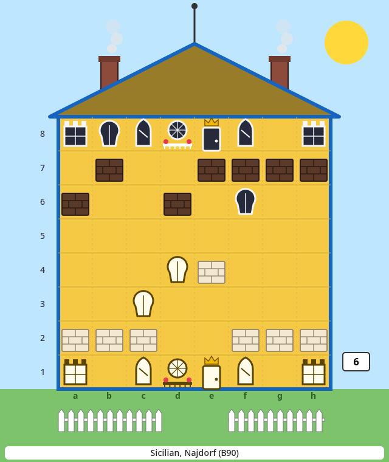
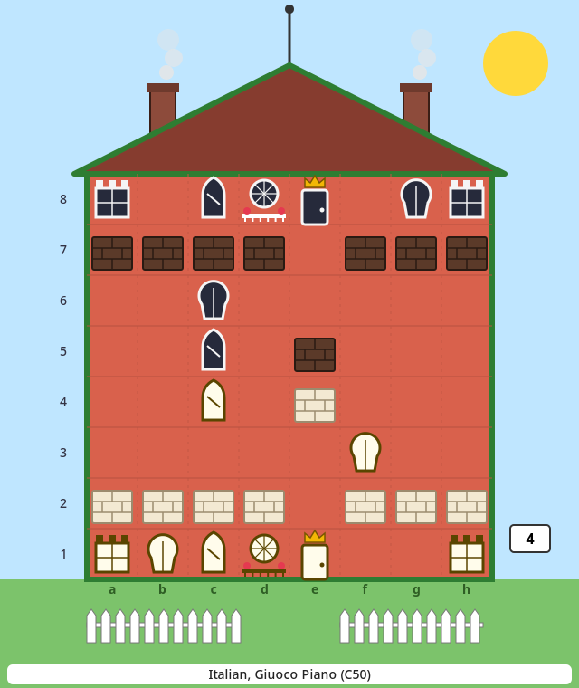
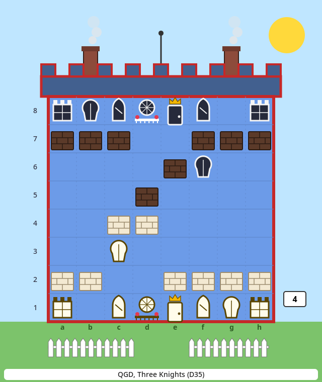
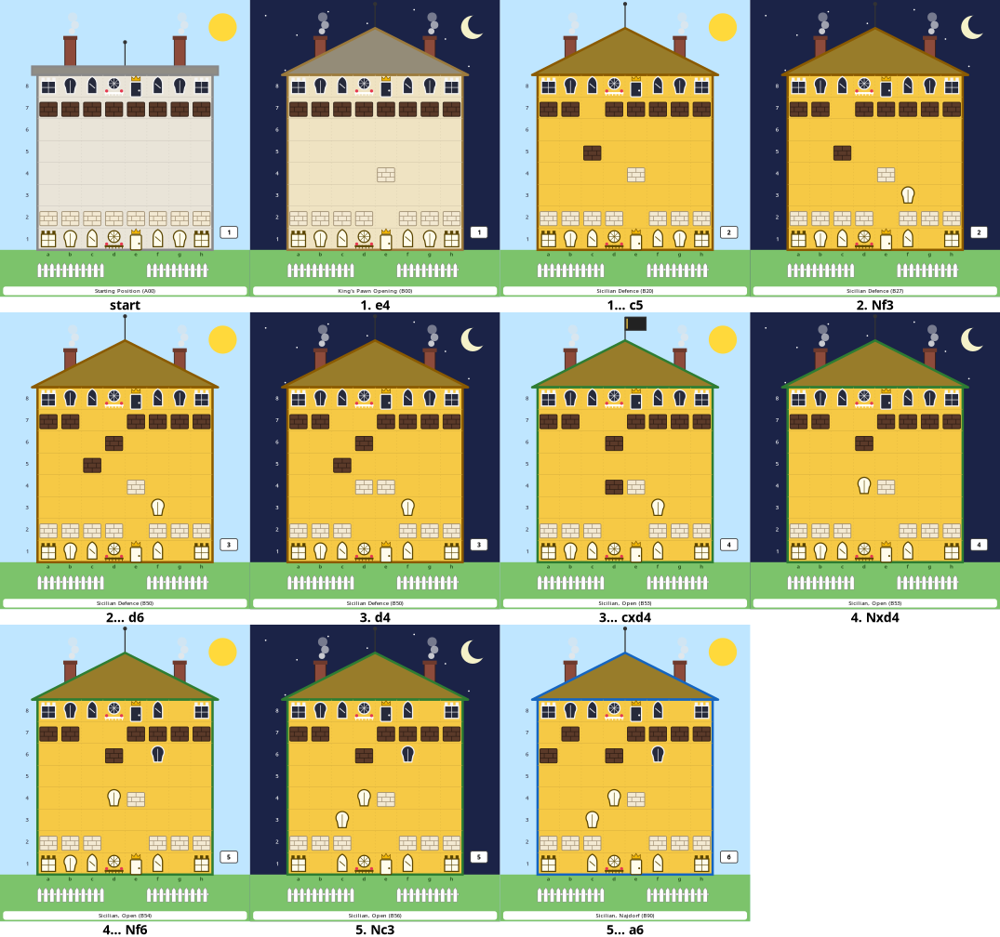

# 🏠♟️ Chess Houses

**Learn chess openings by recognizing houses.**

Kids are visual pattern-matchers. Chess is a pattern-recognition game. Chess Houses
turns every chess position into a **house**: the opening decides the house's *family
look* (wall color, roof, trim), and the exact position is written into the facade
(bricks, windows, doors, balconies). As the game goes on, the house changes shape.
Look at the house and you can tell what's on the board.

| Sicilian Najdorf | Italian Game | Queen's Gambit Declined |
|---|---|---|
|  |  |  |

Move by move (Sicilian Najdorf):



## The rules in 30 seconds

* **Wall color = opening family** (Sicilian yellow, Italian red, QGD blue …). **Roof = first move** (1.e4 pointy, 1.d4 castle).
* The front of the house is an **8×8 grid**: columns a–h, floors 1–8. White lives downstairs, Black upstairs.
* **Brick = pawn · horseshoe window = knight · pointed church window = bishop · tower window = rook · round window with balcony = queen · door with a crown = king.**
* Light glass = White piece, dark glass = Black piece.
* **Day = White to move, night = Black to move.** Fence = White can still castle, chimney smoke = Black can still castle. Roof flag = who's ahead in material.

Full scheme, worked examples and learning path: **[DESIGN.md](DESIGN.md)**.

## Try the prototype

```bash
pip install -r requirements.txt
cd prototype
python house.py --moves "1.e4 c5 2.Nf3 d6 3.d4 cxd4 4.Nxd4 Nf6 5.Nc3 a6" -o najdorf.svg --png
python house.py --fen "rnbqkbnr/pp1ppppp/8/2p5/4P3/8/PPPP1PPP/RNBQKBNR w KQkq - 0 2" -o sicilian.svg --png
python house.py --moves "1.d4 d5 2.c4 e6" --sequence -o qgd_frames/ --png   # one house per move
python house.py --moves "1.e4 e5 2.Nf3 Nc6 3.Bc4" --no-label -o quiz.svg       # hide the name sign
python make_examples.py                                                       # regenerate examples/
```

## Roadmap

- [x] Encoding scheme v0.1 + Python/SVG prototype
- [ ] Web app (TypeScript + chess.js): play moves, watch the house morph
- [ ] Full opening database (Lichess chess-openings) with auto palette
- [ ] Kid games: guess the family, spot the difference, rebuild the board
- [ ] Printable house cards and an illustrated art pass

## License

TBD (MIT suggested).
