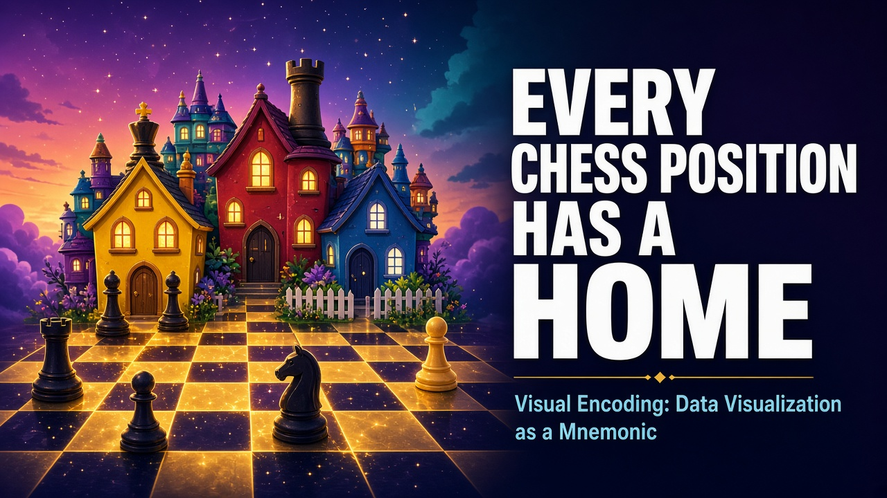
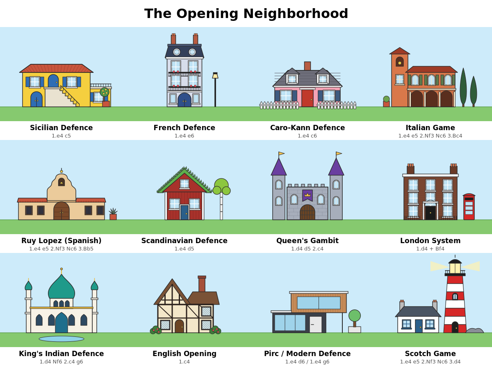
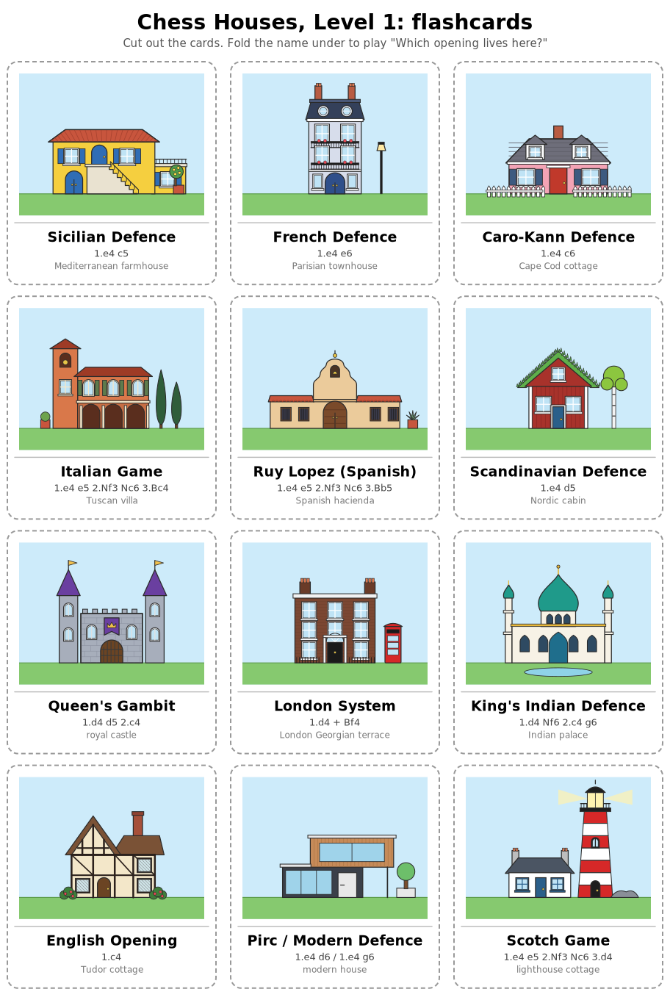
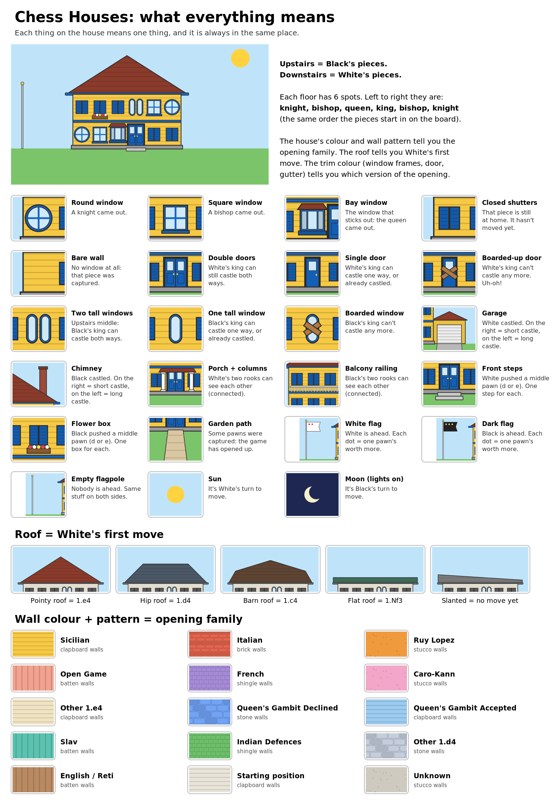
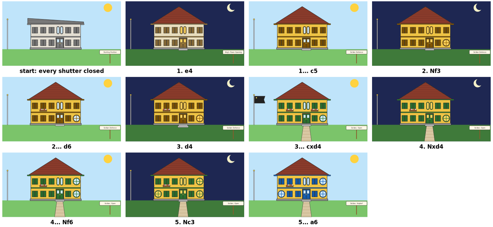

# 🏠♟️ Chess Houses

Chess Houses teaches kids chess openings through visual encoding: data visualization used as a mnemonic, where every opening is a house. Twelve openings share one street, the Opening Neighborhood. Each house has its own silhouette, color, and signature, so a child can name the opening by sight. The sunny yellow farmhouse is the Sicilian, the tall Paris townhouse is the French, and the striped lighthouse is the Scotch.

## Level 1: The Opening Neighborhood

Start here. Nothing about the picture changes with the moves. One opening, one house, every time.



| Opening | House | Signature |
|---|---|---|
| Sicilian Defence | Mediterranean farmhouse (sunny yellow) | outside stone staircase, blue shutters, lemon tree |
| French Defence | Parisian townhouse (Paris blue-grey) | mansard roof with round dormers, iron balconies |
| Caro-Kann Defence | Cape Cod cottage (pink) | two roof dormers, central chimney, white picket fence |
| Italian Game | Tuscan villa (terracotta) | square bell tower, arched loggia, cypress trees |
| Ruy Lopez (Spanish) | Spanish hacienda (adobe sand) | curvy bell gable, big arched wooden doors, iron window grilles |
| Scandinavian Defence | Nordic cabin (Falu red) | grass (sod) roof, white corner trim, birch tree |
| Queen's Gambit | royal castle (stone grey + royal purple) | twin towers with purple cone roofs and flags, crown banner |
| London System | London Georgian terrace (dark brick) | red phone box, black door with fanlight and white columns |
| King's Indian Defence | Indian palace (white marble + teal) | huge onion dome, two minarets, pointed arches |
| English Opening | Tudor cottage (cream + black beams) | black-and-white timber beams, steep gable, tall chimney, roses |
| Pirc / Modern Defence | modern house (charcoal + wood) | stacked boxes, flat roofs, floor-to-ceiling glass |
| Scotch Game | lighthouse cottage (red and white stripes) | tall striped lighthouse with a keeper's cottage |

Printable flashcards. Cut them out and fold the name under to play "which opening lives here?":



Individual houses, with and without the name sign, are in [`examples/level1/`](examples/level1/).

## Level 2+: the house changes with the position

Once the openings are familiar, a normal house tells the story of the position. Ordinary features stand for what happened in the game: which pieces came out, whether the kings castled, and who is ahead. The opening still chooses the look of the house. The full mapping is in [DESIGN.md](DESIGN.md).



Sicilian Najdorf, move by move:



## Alternate styles

Two earlier grid styles are still in the repo. They draw the board onto a house front instead of telling the position as a real house.

* **Facade grid** (`prototype/house.py`, `examples/`): the 8×8 board on the front wall. Exact and reversible.
* **Kid-mode grid** (`prototype/simple.py`, `examples/simple/`): a flat, high-contrast version of that grid, with its own legend.

## Run it

```bash
pip install -r requirements.txt

# Level 1: every house, the neighborhood poster, and the flashcards
python prototype/level1.py --all
python prototype/level1.py --list
python prototype/level1.py --opening french -o french.svg --png

# Level 2+
python prototype/real_house.py --moves "1.e4 c5 2.Nf3 d6 3.d4 cxd4 4.Nxd4 Nf6 5.Nc3 a6" -o najdorf.svg --png
python prototype/real_house.py --legend -o legend.svg --png
python prototype/make_real_examples.py

# Alternate grid styles
python prototype/house.py --moves "1.d4 d5 2.c4 e6" -o qgd_grid.svg --png
python prototype/simple.py --moves "1.d4 d5 2.c4 e6" -o qgd_kid.svg --png
python prototype/make_examples.py
python prototype/make_simple_examples.py
```

## Roadmap

- [x] Level 1: 12 opening houses, neighborhood poster, flashcards
- [x] Level 2 encoding and Python/SVG prototypes (real house, grid, kid grid)
- [ ] Level 2 built on the Level 1 house shapes
- [ ] Web app: play moves and watch the house get built
- [ ] Full opening database, with an automatic colour and style palette
- [ ] Kid games: guess the family, tell the story, build this house
- [ ] Printable house cards and a full illustration pass

## License

TBD (MIT suggested).
